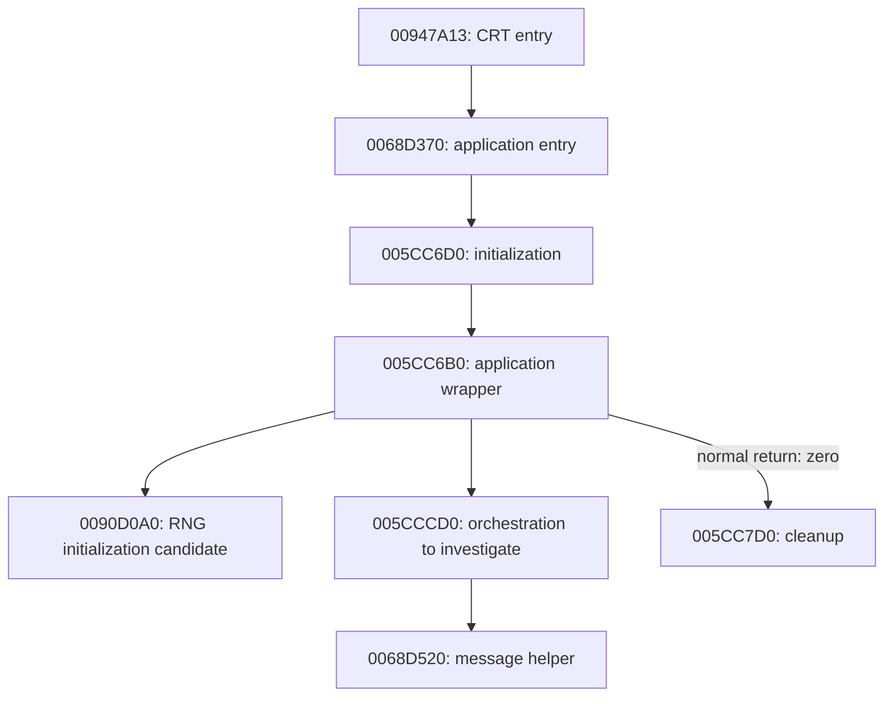

# Startup map: official 3.9.68

Input: `CM0102/Game/cm0102.exe`, SHA-256
`0c78e7da6d0bcb4603fa179449bbe6d1b6b5e1c627a22c445d14d489bd9bff86`.
All addresses below are **preferred-image VAs**, image base `0x00400000`.
Subtract that base for RVAs; convert to disk offsets using `exports/pe.json`.
These are static findings, not evidence of a successful game session.

## Established control flow

| VA | Observed instructions / role | Confidence |
| --- | --- | --- |
| `0x00947A13` | PE entry, runtime startup, command-line/startup-info handling | Entry confirmed; CRT role inferred from instructions/imports |
| `0x00947ADC` | Direct call to `0x0068D370` after four WinMain-style arguments | Confirmed call; WinMain name inferred |
| `0x0068D370` | Saves module handle; mutex and registry setup; calls initialization then application wrapper; cleanup; `ret 0x10` | Confirmed control flow; application entry role strongly supported |
| `0x005CC6D0` | Copies command line to VA `0x00AE2C98`, creates two objects, handles `nomemcheck`; normal return is 1 | Initialization role inferred; instructions confirmed |
| `0x005CC6B0` | Calls `0x0090D0A0(0)`, then `0x005CCCD0`, then **returns zero** | Confirmed; not a passive loop predicate |
| `0x0068D520` | Windows message processing, followed by a clock-like call and global update | Message-pump role supported by import calls; timing semantics unresolved |
| `0x005CC7D0` | Invokes shutdown work, destroys/frees two objects and clears their globals | Cleanup role inferred from instructions |

The apparent loop in the application entry needs care. At `0x0068D4DD` it calls
`0x005CC6B0`, tests EAX, and branches to cleanup when zero. The body would call
`0x0068D520` and repeat the wrapper. But the wrapper's normal path ends in
`xor eax,eax; ret` at `0x005CC6BF`. Its work happens inside `0x005CCCD0`, and
the outer loop is not evidence for a recurring simulation tick. A first-pass
"predicate" label would conceal the main execution path.

`0x005CCCD0` calls the message helper itself at `0x005CCD13`, then starts a
larger initialization/orchestration sequence. Its complete behavior and callees
remain to be mapped. Exceptions, nonlocal exits and indirect callbacks are not
resolved by this initial map.



The diagram shows selected calls and normal sequencing only, not a complete CFG.

## Supporting API and string evidence

At `0x0068D3A0`, the import call is `CreateMutexA`, with string VA `0x009F183C`
(`Championship Manager 2001/02 Process`). `GetLastError` follows at `0x0068D3AB`,
then comparison with `0xB7` and an error/termination branch.

Registry setup uses `RegOpenKeyExA` / `RegQueryValueExA` with the string
`Software\Sports Interactive Ltd\Championship Manager 01-02` at `0x009F17AC`
and value name `Location` at `0x009F17A0`. These observations do not authorize
or require changes to the machine's registry.

Message-helper IAT references are `0x009671F0` (PeekMessageA), `0x009671E4`
(GetMessageA), `0x009671E0` (TranslateMessage) and `0x009671DC`
(DispatchMessageA). Register-indirect calls load those addresses; a generic
call-graph extractor must not silently drop them. See the existing import listing
and Ghidra startup disassembly/references.

## Concrete lead for runtime determinism and the first recovery

`0x0090D0A0` is a promising bounded application routine to investigate next.
It conditionally obtains a value when its argument is zero, passes the resulting
value to `0x009469FA`, references `Random Number seed: %d` at `0x00AD437C`, and
calls `0x00946A04` twice while initializing globals. Its exact ABI, logging,
time dependency and all state effects must be recovered before building a harness.

The helper at `0x009469FA` writes its argument to global `0x00AD6C30`. The helper
at `0x00946A04` multiplies that 32-bit state by `0x343FD`, adds `0x269EC3`, stores
the result, arithmetic-shifts right by 16, masks with `0x7FFF`, and returns it.
These are observed instructions, not an invented RNG. They do **not** prove that
this generator is the entire match/game RNG or that controlling it makes game
execution deterministic. The application's table/state initialization still needs
study. Recovering the small library-like generator alone would not satisfy M3's
application-recovery gate.

## Reproduce and extend

The six main functions have full Ghidra disassembly, references and pseudocode
exports described in [ANALYSIS-SETUP.md](ANALYSIS-SETUP.md). No semantic names
were forced into the project: notes distinguish interpretation from original
symbols. Generated signatures require validation.

For example, Ghidra currently prints only three parameters for `0x0068D370`,
although its caller supplies four and its return instruction pops 16 bytes.
The omitted unused parameter is a concrete reason not to compile raw pseudocode
and assume the calling convention is correct.

Independent spot checks used GNU objdump 2.46, available at
`c:/devkitPro/msys2/usr/bin/objdump.exe`, on an identical analysis copy:

Captured output, tool hash/version, commands, input hash and output hashes are
retained in `CM0102/Analysis/supplemental-startup/` with its `run.json`.

```powershell
objdump -d -M intel --start-address=0x947a13 --stop-address=0x947b09 CM0102/Analysis/baseline-c/cm0102.exe
objdump -d -M intel --start-address=0x68d370 --stop-address=0x68d620 CM0102/Analysis/baseline-c/cm0102.exe
objdump -d -M intel --start-address=0x5cc6b0 --stop-address=0x5cc843 CM0102/Analysis/baseline-c/cm0102.exe
objdump -d -M intel --start-address=0x5cccd0 --stop-address=0x5ccd28 CM0102/Analysis/baseline-c/cm0102.exe
objdump -d -M intel --start-address=0x90d0a0 --stop-address=0x90d126 CM0102/Analysis/baseline-c/cm0102.exe
objdump -d -M intel --start-address=0x9469fa --stop-address=0x946a22 CM0102/Analysis/baseline-c/cm0102.exe
```

The `0x0090D0A0` / `0x0090CFC0` contract is recovered and harnessed in
[RNG-INIT.md](RNG-INIT.md). The full `0x005CCCD0` static map is now in
[ORCHESTRATION.md](ORCHESTRATION.md), including its post-Setup three-phase/day
loop. No recovered engine source is integrated into the original process.
[RUNTIME.md](RUNTIME.md) now demonstrates GDI new game, save/load, progression
and simulated matches; repeated-run determinism and primary runtime remain open.
